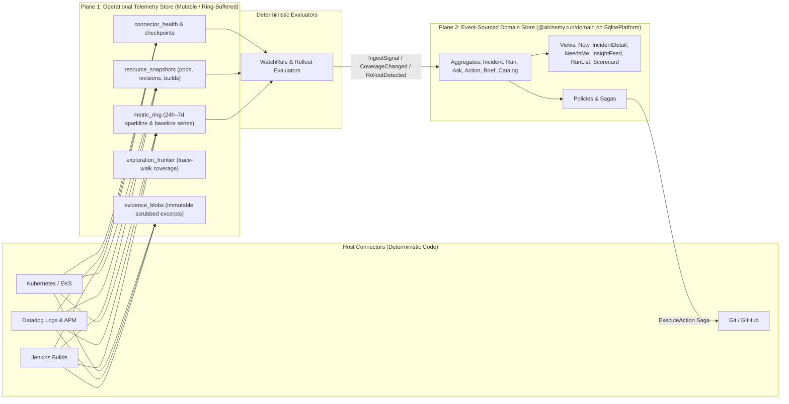
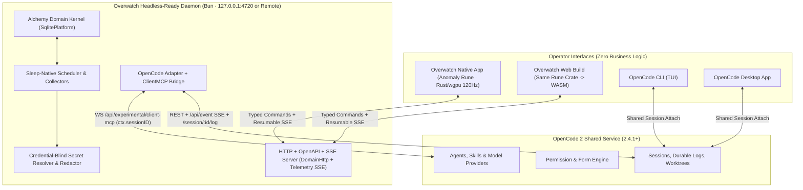
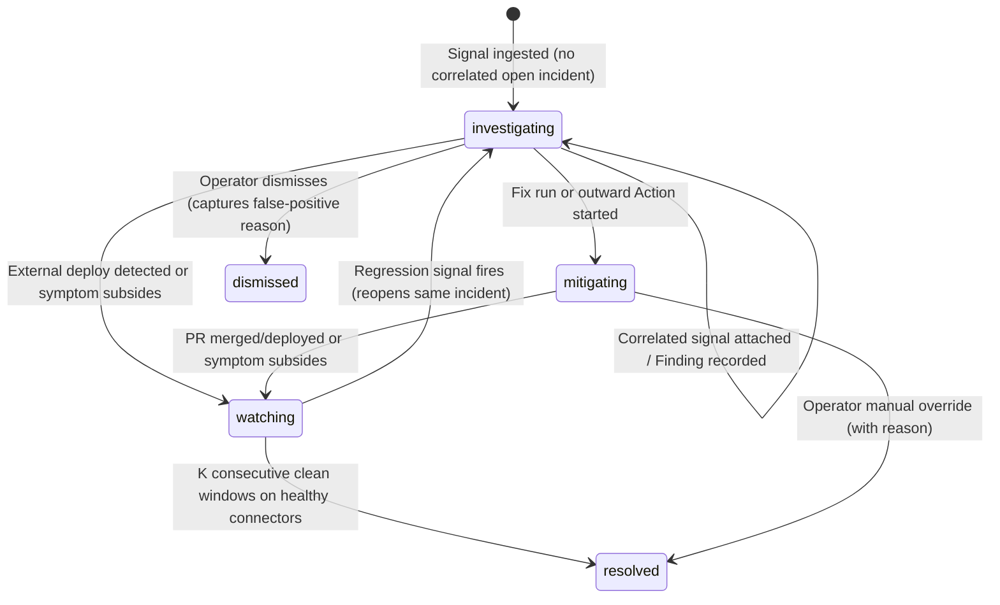

# Overwatch — Final Product & Architecture Plan

**v3 (Final) · November 24, 2026** · Synthesizes and supersedes `INITIAL_PLAN.md` and `PLAN.md`

Overwatch is a local-first autonomous command center for the applications and environments you operate. Running continuously on your Mac alongside the **OpenCode 2** shared service and modeled on **Alchemy Domain** (`@alchemy.run/domain`), it closes the loop between observability, AI investigation, human judgment, and locally verified engineering changes.

Open Overwatch at any moment and it answers three questions at a glance:
1. **What changed across my apps and environments?** (Deployments, pod health, CPU/memory pressure, latency and error shifts, coverage gaps.)
2. **What is an agent already handling?** (Live triage, trace walks, root-cause comparisons, local reproduction, draft PRs.)
3. **What needs my judgment right now?** (A focused decision, permission approval, or outward action sign-off.)

---

## 1. Core Jobs & Governing Rules

Overwatch has four jobs arranged in one continuous loop:

```text
collect ──▶ detect ──▶ correlate & triage ──▶ investigate ──▶ verify & act ──▶ watch recovery ──▶ learn
 (code)     (code)      (code + agent)          (agent)      (agent + saga)       (code)       (judge + you)
```

Four architectural rules govern every feature:

1. **Earn attention; never demand it.** Agents write into schema-validated fields with hard character and line budgets, never raw prose walls. Silence means *healthy and covered*. An offline VPN or expired CLI token renders as **degraded coverage**, never green and never a false-positive incident storm.
2. **Deterministic code detects and decides; models interpret and propose.** Collection, baseline comparison, deduplication, state transitions, budget enforcement, and outward API writes (`gh pr create`, `gh issue create`, email dispatch) execute in deterministic TypeScript/Effect code. Agents read redacted evidence via tools and submit typed domain commands (`RecordFinding`, `RaiseAsk`, `RequestAction`) that aggregates validate and accept or reject.
3. **Ambient local power, role-scoped blast radius.** Overwatch runs directly on the host without container sandboxes, reusing local `kubectl`, `git`, `gh`, and Keychain/env credentials while staying **credential-blind** in setup, storage, UI, and prompts. Untrusted production logs and spans cannot trigger code edits or exfiltration because investigation agents run with shell/edit/network tools disabled at the OpenCode session permission layer; only the `fixer` agent can edit files, strictly inside an isolated Git worktree.
4. **Compounding operational memory.** Every finding, incident, ask, insight, and brief captures 1-click operator feedback and a cross-model LLM `judge` score. Rated incidents become frozen replay cases in `evals/`, gating weekly git-diff proposals that refine app playbooks, connector skills, and detector thresholds.

---

## 2. Operator Experience & Dashboard Surface

### 2.1 A Day in Overwatch

- **09:00 — Morning Sweep.** You open **Now**. Twelve `app × environment` tiles are green; one staging tile shows `coverage: auth_expired` (`aws sso login` needed for staging EKS—no fake alerts fired overnight). **Needs me** is empty. **Insights** surfaces two overnight findings from trace random walks, including an N+1 query creeping up on `billing-worker`. You click **Watch** on one insight, turning it into a standing detector, and **Create issue** on the other.
- **11:42 — Rollout & Detection.** Jenkins finishes build `#482` (`sha: 9f31c2a`) for `checkout-api` and EKS rolls out new pods in `prod`. Overwatch detects the revision change and automatically enters **Rollout Watch** (20s cadence, pinning the pre-deploy 30m window as baseline). Within 90 seconds, p95 latency jumps from `0.9s → 2.1s` AND 5xx errors tick up to `1.8%`. Correlation binds both signals into **one** incident (`INC-42`), fires a macOS notification, and starts a `triage` run.
- **11:44 — First Take & Steering.** `INC-42` displays a 3-bullet understanding, a before/after latency sparkline, the suspect DB span diff, and the Jenkins build diff link. In the incident chat dock, you ask: *"Is this happening on the old ReplicaSet pods too?"* Overwatch steers the live session (`delivery: "steer"`). Two lines and a revision breakdown table come back: old pods are at `0.88s`, new pods (`9f31c2a`) are at `2.15s`.
- **11:50 — Autonomous Local Fix & Draft PR.** You click **Prepare fix**. Overwatch creates an isolated Git worktree at `9f31c2a`, boots a `fixer` session there, reproduces the slow query path via the repo's local verification command, patches the missing index hint, re-verifies locally, and requests `open_draft_pr`. Because `prod`-linked repo pushes default to **Propose**, one card lands in **Needs me**: *"Push branch `overwatch/inc-42-query-plan` & open draft PR? Local check `bun test checkout` passed (42ms vs 890ms)."* You click **Approve**, or click **Open in Terminal / Desktop** to inspect the worktree in OpenCode first.
- **12:30 — Verified Recovery.** Your team merges and deploys `#483`. Overwatch keeps `INC-42` in **`watching`** until 3 consecutive healthy post-deploy windows confirm `p95 ≤ 1.0s` on the new revision, then transitions to **`resolved`**. You mark root cause 👍; `INC-42` is frozen into `evals/cases/`.

### 2.2 Views & Information Architecture

Each screen reads a single domain `View` (plus live telemetry sparklines where applicable) and exposes actions as typed **Intents** (also reachable via `⌘K`):

| View | Purpose | Key Elements & Controls |
| --- | --- | --- |
| **Now** | Single-screen operational cockpit (~10–20 environments) | **1. Needs Me strip** (blocking asks first). **2. Active Incidents** (severity, headline, agent status badge). **3. Fleet Grid** (`App × Environment` tiles showing health, concise reason, evidence age, connector coverage badge, active run indicator). Multi-tag filter bar (`team`, `tier`, `env`, `service`, `region`). |
| **Environment** | Deep workload, pod & build health | **Workload & Revision Matrix** grouping pods by Deployment/ReplicaSet revision (`canary` / `new` vs `stable`) with readiness (`2/2`), restarts + last termination reason (`OOMKilled`, `CrashLoopBackOff`), CPU & memory sparklines, `usage / request / limit` bars, and sample timestamp. **Rollout & Jenkins Build Strip**. Drill-down drawer for pod K8s events, container logs, and APM service traces. **Collect now** button with per-connector progress. |
| **Incident** | One problem, end to end | Header: headline, severity (`page` \| `warn` \| `info`), status (`investigating` \| `mitigating` \| `watching` \| `resolved`), affected scope & tags, next automated check. **Current Understanding** (max 3 bullets, each chipped with clickable `Evidence`). **Collapsible Timeline** (signals, findings, asks, verification bundles, issues/PRs). **Interactive Chat Dock** (`steer` live run or `queue` follow-up) + **Open in Terminal / Open in Desktop** + **Prepare Fix / Create Issue / Draft Update**. |
| **Insights** | Proactive findings before they page | Ranked feed from exploratory runs (trace walks, log signature clustering, resource drift, rollout retrospectives). Shows 1-line claim, 1-line impact, recurrence count, and evidence chips. Actions: **Promote to Incident**, **Watch** (creates standing detector), **Create Issue**, **Dismiss** (with reason chip). |
| **Runs** | Complete audit & session control | Filterable log of every collector tick and agent session: trigger (`signal`, `intent`, `schedule`, `ask_resume`), agent role, model, duration, tool calls, token/USD cost, judge verdict, and **Open in Terminal / Desktop** handoff buttons. |
| **Scorecard & Setup** | System quality & credential-blind config | Precision/noise trends, ask-worthiness rate, judge-operator agreement, weekly diff proposals awaiting review, and **Connector Health / Mapping Preview** (validates what K8s pods, Datadog services, and Jenkins jobs each environment config matches, plus live `probe` results). |

### 2.3 Hard Output Budgets & Progressive Disclosure

`Domain.Rejection` (`OutputBudgetExceeded`) rejects verbose agent writes at the boundary so the agent retries concisely before anything reaches storage or UI:

| Artifact Field | Hard Schema Constraint |
| --- | --- |
| **Incident Headline** | ≤ 80 chars; must include the primary metric/symptom delta |
| **Incident Understanding** | 1–3 bullets, ≤ 140 chars each; every bullet requires ≥ 1 `EvidenceId` |
| **Chat Reply Summary** | ≤ 4 lines (≤ 400 chars) + optional structured table/chart block |
| **Ask** | 1 question (≤ 140 chars), 2–3 structured options + recommended default + 1-line `whyItMatters` (≤ 140 chars) |
| **Insight** | `claim` (≤ 100 chars) + `whyItMatters` (≤ 120 chars) + ≥ 1 `EvidenceId` |
| **Stakeholder Update** | Impact, current status, next update ETA; ≤ 60 words |

Disclosure always follows four layers: **Headline → Understanding → Scrubbed Evidence Excerpt & Source Deep-Link → Full OpenCode Session**.

---

## 3. Domain Primitives & Two-Plane Storage Architecture

### 3.1 Twelve Core Primitives

New capabilities compose these twelve primitives rather than inventing ad-hoc tables:

| Primitive | Role |
| --- | --- |
| **1. App & Environment** | Catalog root. `App` owns local repo path, default branch, worktree setup command, verification commands, and tags. `Environment` binds an `App` to connector scopes (EKS context/namespace/selectors, Datadog site/indexes/service/env tags, Jenkins job path) and autonomy overrides. |
| **2. WatchRule** | Deterministic detector specification (built-in or promoted from an `Insight`): metric/log/pod condition, baseline comparison window, hysteresis count, severity, and fingerprint template. |
| **3. Connector** | Typed host adapter (`Kubernetes`, `Datadog`, `Jenkins`, `GitHub`, `Notifier`) implementing `probe`, `collect`, agent read tools, and deterministic `redact`. |
| **4. Evidence** | Immutable, content-addressed record (`ev_<hash>`): connector source, exact query/selector, time window, deep link, `capturedAt`, and a bounded, secret-scrubbed excerpt or trace-diff payload. |
| **5. Signal** | Output of a `WatchRule` firing on fresh telemetry. Carries `fingerprint` (exact rule dedupe) and `correlationScope` (`appId`, `envId`, optional `workload`/`rolloutId`). |
| **6. Finding / Insight** | Structured agent claim (`kind: root_cause \| ruled_out \| correlation \| drift \| trace_bottleneck`), `confidence`, `EvidenceId[]` (non-empty), and concise text. Unattached findings surface as **Insights**. |
| **7. Incident** | Lifecycle aggregate (`investigating → mitigating → watching → resolved`, plus `dismissed` / `merged`). Owns correlated signals, findings, linked runs, asks, actions, and recovery criteria. |
| **8. Run** | Single execution unit (`collect`, `triage`, `investigate`, `explore`, `fix`, `brief`, `judge`, `propose_improvement`) with trigger, scope, hard budget, status, cost, and optional `SessionID` + worktree path. |
| **9. Ask** | Human-in-the-loop gate unifying OpenCode `permission.asked`, OpenCode `form.created`, agent business/architecture questions, and `Propose`-level `Action` approvals. |
| **10. Action** | Outward side effect (`create_github_issue`, `push_branch`, `open_draft_pr`, `send_brief`) persisted with a deterministic `ActionId` *before* dispatch and executed via an idempotent Saga. |
| **11. Brief** | Audience-tailored communication (`engineer_update`, `stakeholder_update`, `postmortem`, `daily_digest_tech`, `daily_digest_exec`) moving `draft → approved → sent`, capturing user edits as diffs. |
| **12. Verdict & Proposal** | Operator feedback + `judge` rubric scores (`Verdict`), and weekly replay-verified git-diff suggestions to playbooks, skills, or `WatchRule` thresholds (`Proposal`). |

### 3.2 Two-Plane Storage in One `overwatch.sqlite` (WAL Mode)

High-frequency pod metrics must never bloat the domain event log, yet multiple tabs need live telemetry AND formally verified domain decisions. Overwatch splits persistence cleanly inside a single local SQLite file (`~/.local/share/overwatch/overwatch.sqlite`, `PRAGMA journal_mode = WAL`):



- **Why no external Postgres or Docker (resolving v2's #1 risk):** `@alchemy.run/domain` publicly exports `Platform` (`@alchemy.run/domain/Platform`) and `DurableObjects.makePlatform` (`@alchemy.run/domain/DurableObjects`), which implement the entire kernel (aggregates, `commandId` deduplication, per-source sequence checkpoints, views, policies, projections, streams, catch-up, and scheduled commands) atop a 6-method transactional `ObjectStorage` (`get`, `put`, `delete`, `list`, `transaction`) plus per-instance `Semaphore(1)` gates and an alarms table. `packages/sqlite-platform` implements that host plus Effect's `WorkflowEngine` directly on `bun:sqlite` in ~350 lines—giving single-binary local durability, sub-millisecond writes, and 100% compatibility with `Domain.Story` and `Domain.verify`.
- **Boundary rule:** Plane 1 writes domain commands *only* when a `WatchRule` fires (`IngestSignal`), rollout revision changes (`RecordRollout`), or connector coverage/health state transitions (`UpdateConnectorCoverage`). Domain events store compact `EvidenceId` references (`ev_...`), keeping aggregate snapshots tiny while `evidence_blobs` holds the scrubbed excerpts and structured trace diffs.

---

## 4. System Architecture & Verified OpenCode 2 Integration

### 4.1 Process Topology



### 4.2 Exact OpenCode 2.4.1 Integration Mechanics

Every OpenCode integration point has been verified against `@opencode/client@2.4.1`, `@opencode/protocol@2.4.1`, and `@opencode/schema@2.4.1`:

| Concern | Verified Contract & Overwatch Design |
| --- | --- |
| **1. Binary & Service Lifecycle** | Standardize on a single **OpenCode `>=2.4.1`** installation (configured in `overwatch.config.ts` `opencode.binaryPath`, eliminating the local `1.19.6` vs `beta-19157` mismatch). Overwatch calls `ensure({ command, version: (v) => semverGte(v, "2.4.1") })` from `@opencode/client/service` on startup and supervises health. |
| **2. Effect Peer-Dependency Isolation** | `@alchemy.run/domain@2.0.0-beta.87` uses `effect@^4.1.4`, while `@opencode/client/effect` pins `effect@4.1.0`. Overwatch uses `@opencode/client` (`./promise`, `./service`, `./mcp`—zero Effect runtime dependency) wrapped inside `OpenCode.external.ts` (`Domain.ExternalSystem`), avoiding dual-Effect fiber context collisions completely. |
| **3. Deterministic `SessionID` Format** | `@opencode/schema` enforces `Schema.isStartingWith("ses")` (`SessionID.create()` → `"ses_" + descending()`). In the `StartAgentRun` Saga, Step 1 generates and persists `sessionId = SessionID.create()` onto the `Run` aggregate *before* Step 2 calls `POST /api/session` with `{ id: sessionId, ... }`, making session creation 100% retry-idempotent. |
| **4. Dynamic Per-Session Permissions** | `POST /api/session` accepts `permissions: Array<{ action, resource, effect: "allow" \| "deny" \| "ask" }>` evaluated *after* the agent markdown's base rules (last matching rule wins). Overwatch compiles `(agentRoleBaseRules + environmentAutonomyRules)` per session—enforcing `Act / Propose / Never` dynamically per environment without mutating `.opencode/agents/*.md` on disk. |
| **5. Caller-Identified Agent Tools (`connectClientMcp`)** | Using `connectClientMcp` (`@opencode/client/mcp`), Overwatch opens a persistent auto-reconnecting WebSocket to `/api/experimental/client-mcp?name=overwatch`. On every `tools/call`, OpenCode passes `_meta["ai.opencode/sessionID"]` → `ctx.sessionID`! Overwatch maps `ctx.sessionID` to the active `Run` (or `AdHocOperatorSession` if invoked manually from TUI/Desktop), populates `CallerActor` (`Domain.RequestContext`), enforces run budgets and environment scope, and dispatches in-process to `DomainAi.toToolkit(AgentApi)` + scoped Connector read tools. `DomainAi.toMcp` over localhost HTTP (`/mcp`) is mounted in parallel as a fallback transport. |
| **6. Live Stream + Durable Session Catch-Up** | Overwatch subscribes to `GET /api/event` for live `permission.asked`, `permission.replied`, `form.created`, `form.replied`, `form.cancelled`, `session.execution.*`, `session.idle`, `session.usage.updated`, and `session.inbox.delivered`. Because `/api/event` is ephemeral, Overwatch also tracks each active session's `Event.Seq` cursor and catches up after any disconnect or restart via `GET /api/experimental/session/:sessionID/log?after=<seq>`, plus reconciles `permission.request.list` and `form.list`. |
| **7. First-Class Worktrees** | For `fix` runs, Overwatch uses OpenCode's `POST /api/worktree` (`worktree.create({ projectID, branch, directory, name })`) and `worktree.refresh`, so isolated fix worktrees appear natively in OpenCode Desktop's workspace switcher. |
| **8. Portable CLI & Desktop Handoff** | Rather than hardcoding macOS terminal scripts inside domain logic, the server returns a pure **`SessionHandoffDescriptor`** (`{ serviceUrl, sessionId, locationDir, cliCommand, desktopDeepLink }`). Thin clients copy/open `opencode://open-project?directory=<dir>` or `opencode --server <serviceUrl> --session <sessionId>`—working identically whether Overwatch + OpenCode run on `127.0.0.1` today or on a remote headless server tomorrow. |

### 4.3 All-In on Anomaly Rune (`anomalyco/rune`), Dumb-Client Rule & Headless Portability

Zero business logic, anomaly math, deduplication, secret resolution, or direct Datadog/OpenCode calls may live in the UI. The UI is a **100% stateless Rust/Rune projection renderer and `Intent` dispatcher** talking to the Bun daemon over HTTP + OpenAPI (`/openapi.json`) + resumable SSE:

- **Primary UI — Anomaly Rune (`crates/overwatch-app` · Rust + `wgpu`):**
  - **Native 120Hz Desktop + WebAssembly from One Crate:** Compiles natively to macOS (`.app` + menu-bar status pill + global `⌥Space` HUD + multi-tab/split-pane workspace in ~35 MB RAM), Linux, and Windows, **and** compiles to `wasm32-unknown-unknown` (WebGPU/WebGL) so the exact same UI can be served as a web app (`GET /`) when Overwatch is deployed headless!
  - **OpenCode Design-Token & Widget Parity:** Uses `rune-kit` (`@opencode/ui` semantic tokens, tables for pod/revision matrices, split diff viewers for Jenkins/PR/proposal diffs, streaming GFM Markdown with 80+ syntax highlighters, rich `@`-mention chat composer, `⌘K` combobox palette) + `rune-mermaid` (GPU-rendered trace/saga/incident diagrams) + a tiny `crates/overwatch-viz` GPU painter for latency/CPU/memory sparklines and rollout bands.
  - **Zero-Drift TypeScript ↔ Rust Codegen (`crates/overwatch-protocol`):** `DomainHttp.toHttpApi` emits `/openapi.json` directly from Effect `Schema`s; `bun run codegen:protocol` generates strongly typed Rust `serde` structs, `_tag` enums, command payloads, and view states (enforced in CI via `git diff --exit-code`).
  - **Platform-Agnostic Transport (`crates/overwatch-client`):** Isolates HTTP + SSE cursor streaming behind one trait (`reqwest` + `eventsource-stream` on native targets; `web-sys` `fetch` + `EventSource` on `wasm32`), keeping `crates/overwatch-app` views (`fn view(s: &State, cx: &mut Cx<State>) -> El`) completely free of platform `#cfg` clutter.
  - **Closed-Loop Agent UI Verification (`rune-ref`):** Because Rune runs headlessly, OpenCode agents and `cargo test` can boot `overwatch-app` against stubbed SSE streams, script keyboard/click flows, inspect the element tree, and assert golden PNG screenshots with zero browser/Playwright overhead.
- **Headless Swap Seams (Effect `Layer`s Only):** Moving the Overwatch daemon from your MacBook to an always-on headless VM/container requires swapping **only** startup Effect `Layer`s in `packages/server`—never touching `packages/domain`, `packages/connectors`, `agents/`, or `crates/overwatch-app` (which simply points `OVERWATCH_API_URL` at the remote host or loads via WASM in a browser):

| Capability | Local Mac Layer (Default v1) | Headless / Hosted Server Layer (Future) |
| --- | --- | --- |
| **Domain Host (`Platform`)** | `SqlitePlatform` (`overwatch.sqlite` WAL) | `@alchemy.run/domain/EffectCluster` (Postgres) |
| **Caller Auth (`RequestContext`)** | `LoopbackOperatorMiddleware` (`127.0.0.1`) | `OidcOrBearerSessionMiddleware` |
| **Secrets (`SecretVault`)** | `MacOsKeychain` + `EnvVault` | `EnvVault` + AWS Secrets Manager / K8s Secrets |
| **Notifications (`Notifier`)** | `MacOsUserNotification` + Rune HUD toast | Slack / Email / Webhook |
| **Power Management (`HostPowerLease`)** | Bounded `caffeinate -i` during active local verification | `NoOpPowerLease` |
| **OpenCode Runtime** | Local `opencode serve --service` | Co-located headless `opencode serve` container |

---

## 5. Behavioral State Machines & Interaction Flows

### 5.1 Incident Lifecycle & Two-Tier Signal Correlation



**Preventing Multi-Alert Incident Storms (Two-Tier Correlation):**
- **Tier 1 — Fingerprint Deduplication:** Signals carry `fingerprint = hash(envId, watchRuleId, primaryResource)`. Repeat signals while an incident with that fingerprint is open increment `signalCount`, update `lastAnomalyAt`, and append fresh `EvidenceId` without spawning duplicate triage runs (unless severity escalates `warn → page` or the incident regresses from `watching → investigating`).
- **Tier 2 — Scope & Rollout Correlation:** A single bad deploy often triggers latency, 5xx, *and* pod-restart rules within seconds. When a *new* fingerprint fires in `(appId, envId)` during an active **Rollout Watch** window (or within 15 minutes of an already-`investigating` incident in that environment), `SignalCorrelationPolicy` attaches the signal to the existing incident and steers the active session (`"Correlated signal: 5xx rate 1.8% on checkout-api"`). If investigation proves two unrelated causes, the agent calls `overwatch_SplitIncident_send` to fork selected signals and evidence into a separate incident.
- **Hard Recovery Guard:** `ResolveIncident` is rejected by `Incident.decide` unless `(a)` `K` consecutive post-anomaly collection runs completed with `connector.coverage === "healthy"` and zero active breach signals, or `(b)` `CallerActor.kind === "operator"` explicitly overrides. Local test passes and PR merges can advance an incident to `watching`, **never** `resolved`.

### 5.2 Run Lifecycle, Hard Budgets & Two-Way Non-Blocking `Ask` Protocol

```mermaid
sequenceDiagram
  participant User as Operator (Web / TUI / Desktop)
  participant OW as Overwatch Domain + Bridge
  participant OC as OpenCode 2 Session

  OW->>OC: 1. session.create({ id: "ses_...", agent, location, permissions })
  OW->>OC: 2. session.prompt({ delivery: "queue", text: kickoffEnvelope })
  OC->>OW: 3. ClientMCP tools/call (ctx.sessionID) -> Connector / RecordFinding

  alt Case A: OpenCode Permission or Form (e.g. shell / ask rule)
    OC-->>OW: SSE permission.asked { sessionID, requestID, action, resources }
    OW->>OW: OpenAsk(kind: "permission") -> surfaces in Needs Me + macOS notify
    alt Answered in Overwatch Dashboard
      User->>OW: AnswerAsk(askId, "once")
      OW->>OC: session.permission.reply(sessionID, requestID, "once")
    else Answered in OpenCode TUI / Desktop
      User->>OC: Approves in TUI / Desktop
      OC-->>OW: SSE permission.replied { sessionID, requestID }
      OW->>OW: SyncExternalAskResolution(askId) -> clears Needs Me
    end
  else Case B: Domain Question or Action Approval (Propose policy)
    OC->>OW: ClientMCP RaiseAsk / RequestAction(open_draft_pr)
    OW->>OW: OpenAsk(kind: "domain_decision" | "action_approval"), Run -> awaiting_ask
    OW-->>OC: Return { status: "awaiting_ask", directive: "End turn cleanly; OW will resume." }
    OC-->>OW: SSE session.idle (0 resources held; survives sleep & restarts!)
    User->>OW: AnswerAsk(askId, selectedOption)
    OW->>OW: If action_approval -> start ExecuteAction Saga (idempotent GitHub write)
    OW->>OC: session.prompt({ delivery: "queue", text: structuredAnswerOrActionReceipt })
  end
```

**Why Non-Blocking Turn Suspension Matters:** Blocking an MCP tool call while waiting for a human fails after laptop sleep, HTTP timeouts, or OpenCode's 60-minute idle location unload. Returning `{ status: "awaiting_ask" }` lets the agent end its turn cleanly (`session.idle`), consuming zero memory or sockets, and resume hours later in the exact same `sessionID` via `session.prompt`! Furthermore, if the operator opens the session in TUI/Desktop and replies directly in chat while a `domain_decision` `Ask` is pending, Overwatch detects `session.inbox.delivered` (`type: "user"`) and transitions the pending `Ask` to `superseded_by_chat` so **Needs me** never goes stale.

**Hard Run Budgets (Awake-Time Enforced in Wrapper Code):**
Every `Run` defines `{ maxAwakeMs, maxConnectorCalls, maxTotalToolCalls, maxUsd }`:
- Execution timers track **awake monotonic time** (pausing across host sleep intervals so closing your laptop lid overnight never falsely times out an active run on wake).
- At **80%** of call or USD budget, tool responses inject a `_budgetWarning` field instructing the agent to synthesize findings immediately.
- At **100%**, connector query tools return `BudgetExhausted` while keeping `RecordFinding`, `RaiseAsk`, and `CompleteRun` open for one wrap-up turn; exceeding `maxAwakeMs` triggers `POST /api/session/:id/interrupt` and records `RunBudgetExhausted`.

### 5.3 Sleep-Native Local Operation, Adaptive Collection & Auth Resilience

Because Overwatch runs on a laptop that routinely sleeps (overnight, commutes, lid closes), **intermittent host sleep is a first-class lifecycle state**, not an error condition. When deployed headless later, the exact same `WakeCoordinator` simply never observes sleep gaps.

| Environment State | K8s Strategy | Datadog / Jenkins Polling Interval | Notes |
| --- | --- | --- | --- |
| **Quiet / Healthy** | Resource watches + 60s metric poll | `120s` (configurable per env) | Incremental `from = lastCheckpointAt` |
| **Rollout Watch** (new K8s image / Jenkins deploy) | Watch + `15s` metric poll | `20s` for 30m post-deploy | Pins pre-rollout 30m window as comparison baseline |
| **Active Incident / Watching Recovery** | Watch + `15s` metric poll | `20s` until resolved | Focused on affected service/workload selectors |
| **Connector Rate-Limited (`429`)** | Independent | Exponential backoff (`Retry-After`) | Backoffs isolate per `(envId, connector)`; other sources continue |

**End-to-End Sleep & Wake Protocol (`WakeCoordinator`):**
1. **Sleep Detection & Network-Settle Barrier:** A 5-second monotonic heartbeat compares wall-clock `Date.now()` against `performance.now()`. Any jump `> 15s` emits `HostWokeFromSleep(sleptAt, wokeAt, gapMs)` and enters a brief **`waking` barrier** (waiting up to `12s` for macOS Wi-Fi/VPN/DNS reachability to settle and tearing down dead watch/SSE sockets before probing connectors).
2. **Zero Cron Pile-Up (Coalesced Schedules):** All recurring collection and exploration schedules use `@alchemy.run/domain`'s `replace-by-name` (`AggregateStore.schedule`) semantics—500 missed ticks overnight coalesce into **one** post-wake execution. Missed daily deadlines within a catch-up window (e.g., an `08:00` morning brief when the lid opens at `09:15`) wait until Step 3 finishes so the brief includes overnight activity.
3. **Tiered Wake Sweep (No 15-Hour Raw Log Floods, No Missed Overnight Deploys):**
   - **Short Nap (`gap ≤ 15m`):** Normal incremental catch-up (`from = lastCheckpointAt → now`).
   - **Overnight / Weekend Sleep (`15m < gap ≤ 72h`):** Runs three cheap coarse-to-fine queries per environment before resuming live cadence:
     1. *Deploy & Build Diff:* Lists Jenkins builds and K8s revision changes since `sleptAt` (running delayed rollout retrospectives for any deploy that landed while asleep).
     2. *Coarse Rollup Scan:* Queries 5m/15m Datadog timeseries rollups across `[sleptAt, now]` in one request. Transient spikes that already healed overnight are recorded as **Overnight Insights / Timeline Markers**—never paging you at 08:30 for an issue that resolved at 01:10.
     3. *Live Window Evaluation:* Evaluates `[now - 10m, now]` at full fidelity to open incidents only for problems **still active** or regressing now, then fast-forwards live checkpoints.
   - **Extended Offline (`gap > 72h`):** Records an explicit `OfflineGap` marker, fast-forwards checkpoints to `now - 1h`, and captures a fresh baseline before arming detectors.
4. **In-Flight Runs, Recovery Counters & Bounded Power Leases:**
   - Any `Run` that was mid-turn when the Mac went to sleep is reconciled via `session.get` + `session.log?after=<seq>`; if its network turn aborted during sleep and its `Incident` is still active post-wake, Overwatch resumes the same `sessionID` with fresh post-wake evidence attached.
   - Incidents in `watching` reset their consecutive clean-window counter (`0 / K`) across a sleep gap so stale pre-sleep samples cannot prematurely resolve an incident.
   - During short critical local work (`triage` <2m or `fixer` running local verification <5m while lid is open), `HostPowerLease` holds a bounded `caffeinate -i -t 300` idle-sleep assertion so macOS screen-idle doesn't suspend mid-test.
5. **Auth & VPN Failure Circuit Breaking:** On `kubectl` EKS SSO expiry (`Unauthorized`), VPN disconnect (`ETIMEDOUT`), or expired PAT (`401/403`), the connector transitions to `coverage: auth_expired | unreachable`. Detectors **freeze anomaly evaluation** for uncovered rules, tiles render `Coverage Degraded` (never green), and one deduplicated banner guides remediation (e.g., `aws sso login`).

### 5.4 Local Reproduction, Worktree Isolation & Crash-Safe `Action` Sagas

When `Prepare fix` runs (autonomously or via operator click):
1. **Target & Baseline Commit Selection:** Overwatch reads both `app.defaultBranch` (`origin/main`) and the **deployed commit SHA** captured from the K8s pod image tag / Jenkins build `#482`.
2. **Isolated Worktree Provisioning:** `StartFixRun` Saga calls `git fetch` + OpenCode's `worktree.create` (`~/.local/share/overwatch/worktrees/<appId>/<runId>`, branch `overwatch/<incidentSlug>`), runs `app.worktreeSetup` (e.g. `bun install --frozen-lockfile`), and starts `fixer` with `location.directory = worktreePath`. Your primary working directory is **never** touched.
3. **Reproduce → Patch → Verify Contract:** `fixer` attempts local reproduction first (new failing test or reproduction command), applies the minimal fix, and executes `app.verifyCommands` (typecheck, unit/integration tests, and optional local smoke check). It submits `RecordVerificationBundle` (`reproducedLocally: boolean`, `commandsRun`, `exitCodes`, `beforeAfterSummary`, `diffStat`, `unknowns`). If local reproduction is impossible (e.g., prod-only data shape), `reproducedLocally: false` must explicitly state what was verified and what remains unverified.
4. **Crash-Safe Outward `Action` Reconciliation:** Agents never run `git push`, `gh pr create`, or `gh issue create` via shell. Instead, `fixer` calls `RequestAction(open_draft_pr | create_github_issue)`. Once approved (or immediately if `Act`), `ExecuteAction` (`Domain.Saga`) runs:
   - **Step 1 (Reconcile):** Searches GitHub for an existing PR on `head = overwatch/<incidentSlug>` or issue containing `<!-- overwatch-action-id: act_... -->`. If a crash occurred after a prior write, it adopts the existing artifact without duplicating!
   - **Step 2 (Execute):** Pushes the worktree branch using host Git credentials and creates the Draft PR / Issue via `GitHub.external.ts`, embedding cited `Evidence` links, reproduction results, and the `overwatch-action-id` marker.
   - **Step 3 (Track Separately):** Records `ActionCompleted(artifactUrl)`, keeping **Local Verification ✓**, **PR Status (Draft / Merged)**, **Deployment Detected**, and **Production Recovery Verified** as four distinct milestones on the incident. Worktrees auto-prune after PR merge/close once no active session references them.

### 5.5 Exploratory Research & Structured Trace Random Walks

Leftover daily exploration budget powers proactive discovery without drowning models in multi-megabyte trace JSONs:

1. **Weighted Exploration Frontier (`exploration_frontier`):** Rather than stateless random coin-flips, Overwatch scores `(envId, service, route, mode)` candidates by `staleness × trafficWeight × p95ToP50Ratio × recentDeployBoost`, ensuring every active route and service gets explored systematically over a week.
2. **Deterministic Trace-Topology Tools (`Datadog` Connector):**
   - `datadog_list_route_cohorts`: Returns top routes with p50, p95, p99, error %, and week-over-week shift.
   - `datadog_sample_paired_traces`: Samples `2–3` slow/error traces (`p95–p99`) paired with `2–3` median (`p50`) traces for the **exact same route and release version**.
   - `datadog_diff_trace_trees`: Deterministically computes critical-path span breakdown, self-time deltas, **N+1 child-span fan-out counts** (e.g., `SELECT * FROM items` executed 47× vs 2×), and tag skew (`pod_name`, `host`, `tenant_tier`)—returning a compact ~2 KB structural diff + `EvidenceId`.
   - `datadog_drill_span`: Fetches scrubbed span attributes and trace-correlated log lines for a single suspect span.
3. **Recurrence Check & Outcome:** Before recording an `Insight`, `explorer` must verify the pattern across a wider query window (ruling out single-request cold starts). Every run concludes with `RecordInsight`, `AttachFinding` (if matching an open incident), or `RecordInconclusiveExploration` (advancing the frontier timestamp so budget isn't wasted re-checking immediately). Clicking **Watch** on any `Insight` compiles a parameterized `WatchRule` into the catalog.

### 5.6 Multi-Window / Multi-Tab Consistency & Client Protocol

- **Commands & Read-Your-Writes:** Native Rune workspace tabs/windows (and WASM browser tabs) send commands via `POST /api/domain/<Command>` with deterministic per-gesture `commandId`s. Domain command receipts return `{ stream, version }`; immediate view reads pass `?stream=<stream>&version=<version>` (`AtLeastQuery` built into `DomainHttp.toHttpApi`) so no pane or window ever renders stale pre-command state.
- **Gap-Free Live Updates:** `crates/overwatch-client` maintains resumable SSE streams to `DomainHttp` (`/api/domain/Now/global/watch` or `/events?after=<cursor>`) plus `/api/telemetry/stream` (1 Hz batched pod/metric version ticks and collection progress). Reconnecting clients (after daemon restart, network switch, or laptop wake) pass their last `cursor`, replaying missed transitions seamlessly with zero polling loops.

---

## 6. Connectors, Credential-Blind Security & Role Isolation

### 6.1 Connector Specifications

Every connector implements one Effect service contract (`probe`, `collect`, `tools`, `redact`) tested against recorded HTTP/CLI fixtures:

| Connector | Host Auth Resolution (Credential-Blind) | Scoped Config (`overwatch.config.ts`) | Core Operations & Guardrails |
| --- | --- | --- | --- |
| **Kubernetes / EKS** | Ambient `~/.kube/config` + AWS CLI/SSO exec profile (`kubectl --context <ctx>`) | `kubeContext`, `namespace`, `workloadSelectors`, `containerNames` | Always passes `--context` + `--namespace` + `--request-timeout=10s` explicitly (never relies on mutable current-context). Reads Deployments, ReplicaSets, Pods, Warning Events, Logs (`--tail`, `--since-time`), and `metrics.k8s.io` pod metrics (gracefully marking metrics `unavailable` if Metrics Server is absent). All mutating `kubectl` verbs are hard-denied. |
| **Datadog** | `SecretRef` (`keychain:overwatch/dd-api-key` + `keychain:overwatch/dd-app-key` or `env:*`) | `site` (e.g. `datadoghq.com`), `logIndexes`, `serviceTag`, `envTag` | Injects `DD-API-KEY` + `DD-APPLICATION-KEY` inside Overwatch process only. Scopes every log/APM/metric query by configured `index`, `service`, and `env` tags + bounded time window and row cap. Provides paired trace sampling and structural span-tree diffing. |
| **Jenkins** | `SecretRef` (`username` + `keychain:overwatch/jenkins-pat`) | `baseUrl`, `jobPaths`, `branchFilter` | Reads build history, SCM revision (`gitCommit`), parameters, duration/result, and bounded failure console tail; correlates build SHA to K8s pod image tags/annotations. |
| **Git / GitHub** | Ambient host `git` SSH/credential-helper + `gh auth` | `repoPath`, `remote`, `defaultBranch`, `githubRepo` | Read-only git log/diff/blame for investigators; isolated `git worktree` provisioning for `fixer`; idempotent `gh issue create` and `gh pr create --draft` inside `ExecuteAction` Sagas. |

**Two-Pass Redaction (`redact`):** Before any connector payload enters `evidence_blobs`, UI views, or MCP tool responses, deterministic regex + key-name scrubbers strip Bearer/Basic headers, API keys/JWTs, AWS keys, DSN connection passwords, cookies, and configurable custom patterns, replacing them with `[REDACTED:<kind>]` and truncating payloads to bounded byte caps.

### 6.2 Defeating Telemetry Prompt Injection Without Sandboxes

Production logs and HTTP span tags contain untrusted external input. Overwatch eliminates the "lethal trifecta" (*untrusted input + local shell/write + outbound network*) by strictly separating agent roles via OpenCode per-session permission rulesets:

| Agent Role | Default Model Tier | OpenCode File / Shell / Web Permissions | Allowed Overwatch MCP Tools |
| --- | --- | --- | --- |
| **`triage`** | Fast frontier (low latency) | `edit: deny`, `write: deny`, `shell: deny`, `webfetch: deny` | Scoped connector reads, `RecordFinding`, `UpdateUnderstanding`, `RaiseAsk`, `CompleteRun` |
| **`investigator`** | Deep reasoning | `edit: deny`, `write: deny`, `shell: allow(git log/show/diff/grep read-only)`, `webfetch: deny` | Scoped connector reads + trace diff tools, `RecordFinding`, `SplitIncident`, `RaiseAsk`, `RequestAction(create_github_issue)` |
| **`explorer`** | Balanced / cost-efficient | `edit: deny`, `write: deny`, `shell: deny`, `webfetch: deny` | Scoped connector reads + trace-walk tools, `RecordInsight`, `RecordInconclusiveExploration` |
| **`fixer`** | Coding frontier | `edit/write: allow` (**inside worktree only**), `shell: allow(repo verify/test, git status/diff/add/commit)` · **`deny(git push, gh *, kubectl *, aws *, curl, wget)`** | Read incident findings & scrubbed `Evidence`, `RecordVerificationBundle`, `RaiseAsk`, `RequestAction(open_draft_pr)` |
| **`scribe`** | Fast frontier | All local tools `deny` | Read incident/run/evidence summaries, `SaveBriefDraft`, `RequestAction(send_brief)` |
| **`judge`** | Distinct model family | All local tools `deny` | Read run transcript, cited `Evidence` & output, `RecordVerdict` |

Because `triage`, `investigator`, and `explorer` have `shell`, `edit`, and `webfetch` denied (and thus removed from their tool registry by OpenCode 2), a hostile prompt embedded in a Datadog log line physically cannot execute commands, touch files, or exfiltrate host credentials.

---

## 7. Evaluation, Calibration & Self-Improvement

1. **Zero-Friction Feedback Capture:**
   - *Explicit:* 1-click 👍/👎 with reason chips (`wrong_cause`, `noisy`, `too_verbose`, `missing_evidence`, `bad_severity`, `unnecessary_ask`) on every Finding, Incident close, Ask, and Insight.
   - *Implicit:* Time-to-acknowledge, incident reopen rate, insight promote-vs-dismiss ratio, PR merged-vs-closed without merge, and exact character diffs when you edit a drafted `Brief`.
2. **Cross-Model `judge` Rubric:** After each agent run completes, a lightweight `judge` run (configured to use a different model provider/family than the worker) evaluates five binary/graded axes: **Grounded** (every claim supported by cited `EvidenceId`), **Concise** (within budget, high signal density), **Actionable**, **Severity-Calibrated**, and **Scope-Disciplined**.
3. **Judge Calibration Gate:** Scorecard tracks agreement (`κ` / % match) between `judge` verdicts and your explicit ratings. Disagreements automatically append few-shot counterexamples to the judge rubric. Automated prompt/threshold gating only activates once agreement exceeds **85%** over ≥ 30 rated runs.
4. **Frozen Replay Suite (`evals/`):** Closing or rating an incident exports a self-contained case (`evals/cases/inc-42.json`: initial signals, frozen `Evidence` blobs, connector tool fixtures, and human ground-truth verdict).
5. **Weekly Reviewed Diffs (`propose_improvement`):** Once per week (or on demand), an improvement run analyzes accumulated feedback and proposes concrete Git diffs delivered as `Ask`s—such as adding a service quirk to `agents/playbooks/checkout-api.md`, tuning a noisy `WatchRule` threshold in `overwatch.config.ts`, or tightening an agent instruction—with before/after replay scores attached. Nothing merges without your approval.

---

## 8. Formal Verification, Invariants & Codebase Blueprint

### 8.1 Three-Tier Verification Strategy

1. **Exhaustive Concurrent `Domain.Story` Specs (`@alchemy.run/domain/Story`):** Every command, policy, and saga begins as an executable `Story` with stubbed `ExternalSystem`s and a deterministic clock. Alchemy's story runner explores **every valid interleaving** of concurrent policies and saga steps (enforcing `≤ 256` orderings so concurrency never grows intractable). Mandatory multi-actor stories from Milestone 1:
   - *Concurrent Tab Ask Race:* Tab A and Tab B submit conflicting answers to `Ask-1` simultaneously → exactly one commits `AskAnswered` and dispatches once; the second receives the recorded outcome.
   - *Crash Mid-External Write:* `ExecuteAction(open_draft_pr)` creates the PR on GitHub, crashes before recording `ActionCompleted`, restarts, reconciles via branch/marker lookup, and adopts the existing PR URL with zero duplicates.
   - *OpenCode External Reply Race:* Operator approves a permission in OpenCode TUI at the exact moment Tab A clicks Reject in Overwatch → clean convergence without stuck `Needs me` state.
   - *Premature Recovery Rejection:* `fixer` passes local tests and opens a PR while production telemetry is either still degraded or `coverage === "unreachable"` → `Incident` stays `mitigating`/`watching`, never `resolved`.
   - *Overnight Laptop Sleep Mid-Incident:* Clock jumps `+10h` while `Run-1` is executing and `INC-42` is `watching` (`2/3` clean windows) → `Run-1` does not fail on awake-time budget, schedules coalesce to a single `WakeSweep`, `watching` resets to `0/3`, and healed overnight spikes record as historical insights rather than paging.
2. **Static Model Wiring Check:** `Domain.verify(OverwatchModel)` runs in CI (`bun test`) to guarantee zero orphan events, missing policy handlers, or >64-character MCP tool names.
3. **Property-Based State Machine Fuzzing:** Fast-check generators fire bounded random sequences of signals, coverage dropouts, sleep jumps, asks, and resolutions against pure `decide`/`evolve` functions, asserting 7 core invariants after every step:
   - At most one open primary incident per `(envId, fingerprint)`.
   - Every persisted `Finding` and `Insight` references `≥ 1` existing `EvidenceId`.
   - Every `Action` dispatch is preceded by a durable `ActionRequested` event and (when policy is `Propose`) an `AskApproved` event matching its `actionId`.
   - Replaying the event log rebuilds bit-identical `View` states and triggers **zero** `ExternalSystem` calls.
   - Uncovered/auth-expired connectors never emit healthy recovery windows or false anomaly signals.
   - Every text field satisfies its byte/line budget schema.
   - No `Incident` reaches `resolved` via automated policy without `K` fresh healthy post-anomaly observations.

### 8.2 Workspace Layout & Typed Config

```text
overwatch/
  overwatch.config.ts            # Schema-validated catalog, secret refs, budgets & autonomy rules
  Cargo.toml                     # Rust workspace for Anomaly Rune native + WASM client
  packages/                      # Headless-ready Bun + TypeScript + Effect backend
    domain/                      # Pure @alchemy.run/domain aggregates, commands, events, views, policies, sagas, stories
    sqlite-platform/             # Local DurableObjects.Host + WorkflowEngine on bun:sqlite (WAL)
    connectors/                  # kubernetes, datadog, jenkins, github, notifier + redactor + fixture contract tests
    server/                      # Bun daemon: sleep-native scheduler, telemetry store, OpenCode adapter + ClientMCP, HTTP/SSE
  crates/                        # Zero-business-logic Anomaly Rune UI (targets macOS/Linux/Win + wasm32)
    overwatch-protocol/          # Auto-generated Rust serde types from DomainHttp /openapi.json
    overwatch-client/            # HTTP command + resumable SSE client (reqwest native / web-sys wasm32)
    overwatch-viz/               # Custom Rune GPU sparklines, rollout baseline bands & utilization bars
    overwatch-app/               # Declarative Rune views, multi-tab/split-pane shell, menubar HUD & rune-ref headless tests
  agents/
    agents/                      # .opencode/agents/overwatch/{triage,investigator,explorer,fixer,scribe,judge}.md
    skills/                      # Connector query patterns & investigation recipes
    playbooks/                   # Per-app operational knowledge (evolved via reviewed proposals)
  evals/
    cases/                       # Frozen incident & exploration replay fixtures
    rubrics/                     # Calibrated judge rubrics
```

```ts
// Example: overwatch.config.ts (credential-blind, schema-validated)
import { defineConfig } from "@overwatch/domain/config";

export default defineConfig({
  opencode: { binaryPath: "/Users/brandon/.opencode/bin/opencode", minVersion: "2.4.1" },
  budgets: {
    dailyUsdCap: 15.0,
    triage: { maxAwakeMs: 120_000, maxConnectorCalls: 12, maxUsd: 0.75 },
    explore: { maxAwakeMs: 180_000, maxConnectorCalls: 20, maxUsd: 1.00 },
    fix: { maxAwakeMs: 600_000, maxConnectorCalls: 15, maxUsd: 3.00 },
  },
  apps: [
    {
      id: "checkout-api",
      repoPath: "/Users/brandon/Development/checkout-api",
      defaultBranch: "main",
      worktreeSetup: ["bun install --frozen-lockfile"],
      verifyCommands: ["bun run typecheck", "bun test"],
      tags: { team: "payments", tier: "critical" },
      environments: {
        prod: {
          cadenceSeconds: 60,
          kubernetes: { context: "eks-prod-us-east-1", namespace: "checkout", selector: "app=checkout-api" },
          datadog: {
            site: "datadoghq.com",
            apiKey: "keychain:overwatch/dd-prod-api-key",
            appKey: "keychain:overwatch/dd-prod-app-key",
            indexes: ["prod-main"],
            service: "checkout-api",
            env: "prod",
          },
          jenkins: {
            baseUrl: "https://jenkins.internal.example.com",
            username: "env:JENKINS_USER",
            token: "keychain:overwatch/jenkins-pat",
            jobPath: "job/payments/job/checkout-api/job/main",
          },
          autonomy: {
            investigate: "act",
            prepareWorktreeFix: "act",
            createGithubIssue: "propose",
            openDraftPr: "propose",
          },
        },
      },
    },
  ],
});
```

---

## 9. Streamlined Implementation Milestones

| Milestone | Scope | Exit Criteria ("Done When") |
| --- | --- | --- |
| **M0 — Foundation, Rune Shell & Handoff Proof** *(2–3 days)* | Bun + Cargo workspace (`effect@^4.1.4`, Rust latest stable via `rustup` + `wasm32-unknown-unknown`), `packages/sqlite-platform`, OpenAPI → `crates/overwatch-protocol` codegen, minimal `overwatch-app` Rune window + `rune-ref` headless PNG test, and OpenCode `2.4.1+` `connectClientMcp` + session handoff proof. | Rune native window (and WASM build) streams a live view from the Bun daemon; a test `Run` calls an Overwatch MCP tool identified via `ctx.sessionID`, survives daemon restart, renders a headless PNG in `cargo test`, and opens in Terminal & OpenCode Desktop. |
| **M1 — Watch (Deterministic GPU Cockpit)** | Catalog & `overwatch.config.ts` loader, SecretResolver + Redactor, Kubernetes & Datadog connectors, Plane-1 telemetry store, `WakeCoordinator` + VPN/SSO circuit breakers, `overwatch-viz` GPU sparklines, **Now** and **Environment** Rune views (multi-tab/pane), **Collect now**. *Zero LLM calls.* | Two Rune windows (or native + WASM tab) trigger `Collect now`, render 120Hz K8s pod revisions/CPU/memory and Datadog p95 sparklines, survive closing/reopening, and show `auth_expired` without false alerts when offline. |
| **M2 — Respond (Incidents, Triage & Needs Me)** | `WatchRule` evaluators, two-tier signal correlation, `Incident` + `Run` + `Ask` aggregates & concurrent `Story` suite, `triage` & `investigator` agents, **Incident** view with chat steering (`steer`/`queue`), bidirectional **Needs me** sync with TUI/Desktop, macOS notifications, feedback chips. | A simulated or real latency spike opens one correlated incident, posts a grounded 3-bullet first take within budget in <2m, answers a follow-up revision question, and syncs permission/ask approvals across dashboard and TUI. |
| **M3 — Act (Jenkins, Rollout Watch & Verified Draft PRs)** | Jenkins build correlation, automatic **Rollout Watch** baseline pinning, `worktree.create` isolation, `fixer` agent + `VerificationBundle`, crash-safe `ExecuteAction` Saga for GitHub Issues & Draft PRs, hysteresis-guarded `watching → resolved` loop. | A known sample regression correlates to its Jenkins build, reproduces & verifies a fix inside an isolated worktree, gates PR creation through **Needs me**, survives mid-write process kill without duplicate PRs, and resolves only after fresh healthy telemetry. |
| **M4 — Discover & Compounding Memory** | Weighted `ExplorationFrontier`, Datadog paired trace-diff tools (`explorer`), **Insights** feed + 1-click **Watch** rule promotion, cross-model `judge`, `evals/` case export & replay runner, weekly diff `Proposal`s, **Scorecard** view. | An unattended trace walk surfaces a grounded N+1/latency insight with paired trace diff evidence; a prompt or threshold edit is evaluated against frozen `evals/` cases before approval. |
| **M5 — Communicate & Daily Team Briefs** | `scribe` agent, engineer & 60-word stakeholder incident updates, resolution postmortem drafts, edit-diff feedback capture, and scheduled technical + non-technical **Daily Brief** email service (`Notifier` external + `Action` gate). | One click copies a 60-word stakeholder update; scheduled morning digest renders clear technical (traces/builds/PRs) and executive (impact/recovery/open decisions) briefs from event history. |

---

## 10. Day-1 Pilot Configuration Checklist

Before writing Milestone 0 code, lock in these five concrete values for `overwatch.config.ts`:
1. **Pilot App & Environment:** Repo path, EKS context + namespace, Datadog service/index, and Jenkins job path for the first service.
2. **Canonical First Question:** The #1 recurring investigation you currently run manually (e.g., *"Did the latest rollout regress p95 latency or error rate, and which span/commit caused it?"*).
3. **Toolchain & OpenCode Standardization:** Align OpenCode CLI and Desktop to `2.4.1+` (`opencode.binaryPath`) and update Rust to current stable (`rustup` `1.85+` + `wasm32-unknown-unknown`, as Homebrew `rustc` is currently `1.80.1`) for `anomalyco/rune`.
4. **Model Pairing:** Primary worker model(s) for `triage`/`investigator`/`fixer` + a separate provider/family for `judge`.
5. **Initial Daily Budget:** Default `$15/day` ceiling (`$10` reactive reserve, `$5` exploratory random walks).
