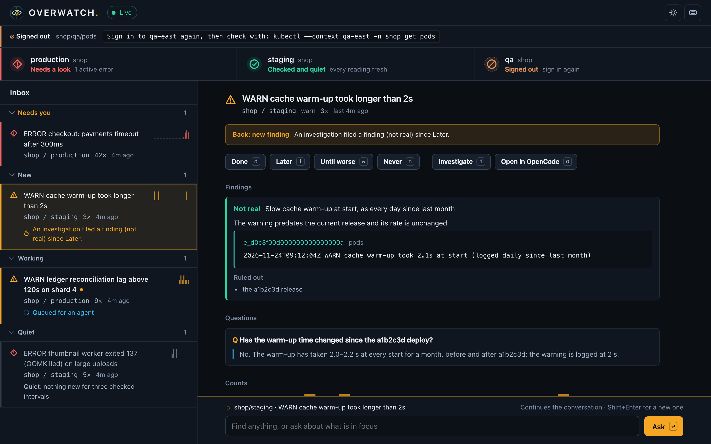

# Overwatch

Overwatch watches your apps on Kubernetes and Datadog from your laptop, counts what goes wrong exactly where it
read everything inside limits it writes down, marks every other total as a lower bound, says honestly when it does
not know, and lets an OpenCode model investigate with evidence it cannot invent. It is one Node process and one SQLite file, built on [Effect](https://effect.website) 4 for the service and [Foldkit](https://foldkit.dev) (on Effect) for the page.

This is the **simple core, milestones 1 to 3**: the kernel, the tools for proving it on a real laptop and a real
model, the page, and the agents.
Specification: [docs/plans/simple-core.md](docs/plans/simple-core.md) with its
[amendments](docs/plans/simple-core-amendments.md) and [interfaces](docs/plans/simple-core-interfaces.md).
The agents are OpenCode sessions on your own model; nothing depends on a model being right. Code adjudicates
independent readings and a challenger, evidence is cited by handle, and disagreement is shown as disagreement.



## In one minute

```sh
git clone <this repository> overwatch && cd overwatch     # Node 24, or 22.16 or newer
pnpm install                                              # Effect, and the page's bundle (pnpm run build:web)
bin/overwatch check  --config ~/.config/overwatch/config.json
bin/overwatch serve  --config ~/.config/overwatch/config.json   # then open the address it prints
bin/overwatch status --config ~/.config/overwatch/config.json
bin/overwatch doctor --config ~/.config/overwatch/config.json
bin/overwatch demo   --config ~/.config/overwatch/config.json   # a seeded, isolated picture; contacts nothing
bin/overwatch install --config ~/.config/overwatch/config.json  # run it at login (launchd); docs/setup.md
```

## What exists

- **Storage**: one SQLite file owned by one process through SQLite's own exclusive lock; every change is one
  transaction that appends to an append-only event log; text is stored only after redaction.
- **Collection**: Kubernetes through read-only `kubectl` (logs, events, workloads, usage) and Datadog (logs, monitors,
  a metric), counted by keys made from each source's own data, so replay, crash and late data never count twice; a
  total over a window that was not fully read is marked as a lower bound.
- **Health**: each environment is quiet, needs a look, partial, stale or signed out, from the least-known reading
  and the problems active now.
- **Failures**: classified (sign-in, permission, rate limit, unreachable, configuration), backed off, suspended and
  probed; one cause per failure; "offline" only when several independent endpoints all fail.
- **The page**: the environments strip, the inbox in four groups whose rows never move under you, Done, Later and
  Never with undo and a reason for everything that comes back, a finder, and one bar that asks about what is in
  focus. Moving, deciding, undoing, finding and asking are on the keyboard (a source is reached by a click or the
  finder). It keeps its own clock, says stale or down by itself, and ages each environment's measurements too.
- **Agents**: investigations by independent readings and a challenger, adjudicated by code; answers to your
  questions where you asked them; "Was this right?" corrections that reach the next investigation; briefs to copy;
  local notifications; and owner tools plus a skill so any OpenCode session of yours can read and act on the inbox.
- **Fixes**: for an app that opts in, a confirmed problem that began after one deployment gets a verified candidate
  that reverts one commit of that deployment or restores one setting. A model only selects; code derives the change
  from Git, checks it and verifies it in isolation (macOS). You see the diff and the verify result; a draft pull
  request is opened only when you press `Shift-P`. Nothing is ever merged by Overwatch.
- **Looking ahead**: time left on a capacity metric, shown only when six consistent readings support it; and a
  staging release compared with unchanged production, where a new staging-only problem becomes an inbox item.
- **Commands**: `check`, `serve`, `status`, `backup`, `restore`, `doctor`, `trial`, `demo`, `install`, `uninstall`, `restart`.
- **Investigation tools** over MCP, with evidence by handle, and `trial`, which measures your model on five seeded
  cases before any automation is allowed for that model.

## Documentation

- [docs/setup.md](docs/setup.md): install, configure, connect OpenCode, run, back up.
- [docs/using.md](docs/using.md): what the service does, health, failures, the commands and their output.
- [docs/customizing.md](docs/customizing.md): the configuration grammar and the operating limits.
- [docs/design-philosophy.md](docs/design-philosophy.md): why it is shaped this way.
- [AGENTS.md](AGENTS.md): rules for people and agents changing the code.

## Tests

```sh
pnpm install          # the tools, and the page built into web/dist
pnpm run build:web    # build the page again after changing web/src
pnpm run check        # typecheck (service and page) and the tests in test/ and web/test/
pnpm run accept       # the milestone 1 acceptance suite in accept/m1 (M1_LONG=1 for the release run)
node --no-warnings --test --test-concurrency=2 accept/m2/*.test.mjs   # the page contract (system Chrome; build first)
node --experimental-strip-types --no-warnings test/real/screenshots.ts  # screenshots of the demo
```
